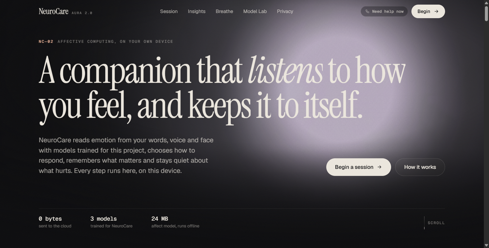
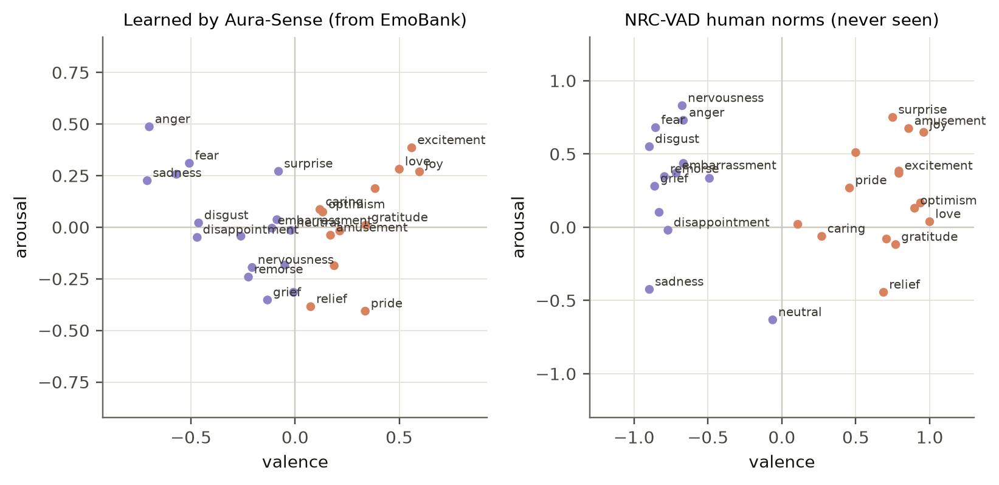
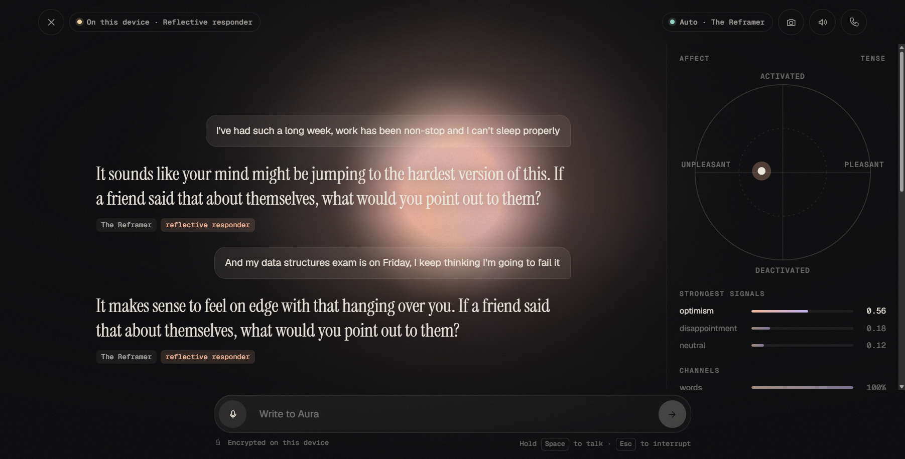

<div align="center">

# NeuroCare · Aura

**A companion that listens to how you feel, and keeps it to itself.**

A private, on-device mental-health companion that uses affect as a control signal:
what you seem to feel decides when it steps aside for a human, how it responds, and what it remembers.

[Paper](paper/neurocare.tex) · [Project report](docs/NeuroCare_Project_Report.docx) · [Deploy](docs/DEPLOYMENT.md) · [Reproduce](docs/DEVELOPMENT.md)



</div>

---

## What is new here

Most companions treat emotion as something to display. NeuroCare closes the loop.

| | |
|---|---|
| **Aura-Sense** | One 22M-parameter encoder, trained jointly for 28 emotions, valence and arousal, crisis risk and cognitive distortions. A single forward pass gives the affect reading **and** the embedding used for memory search. Retrieval-preserving self-distillation keeps that embedding useful; a learned circumplex places every emotion on the valence–arousal plane and agrees with human norms it never saw. |
| **AGEM** | Affect-Gated Episodic Memory. Recalls what matters, holds painful memories back when they are not the topic, and does not repeat itself. |
| **Safety gate** | A C-SSRS-organised lexicon plus the risk head, in front of the language model. In a crisis the model is bypassed and helplines are shown. |
| **Aura-Face** | Facial expression from 52 blendshape coefficients, never pixels. Runs in the browser. |
| **Zero-server mode** | The whole loop runs in a browser tab (WebAssembly, encrypted IndexedDB, optional Llama on WebGPU), verified against the Python server by tests. |

## Results

All numbers come from `research/` on held-out data; [`research/results/tables.md`](research/results/tables.md) has every table.

| | |
|---|---|
| Emotion, 28 classes (GoEmotions) | macro-F1 **0.49** · Ekman 7-class **0.62** |
| Crisis risk (Reddit, n = 10,000) | AUROC **0.995** |
| Retrieval geometry kept (STS-B ρ) | **0.831**; base encoder 0.820, without distillation 0.643 |
| Learned emotion map vs human norms (NRC-VAD) | valence r = **0.85** |
| Painful-memory resurfacing, AGEM vs plain retrieval | **0%** vs 28%, at the same recall (0.95) |
| Safety gate, held-out short messages | crisis recall **0.90**, alert recall **1.00**, no idiom false alarms |
| Facial affect from blendshapes (AffectNet, 8 classes) | **51.6%** accuracy (chance 12.5%) |
| Affect model in the browser | **24 MB**, embedding cosine 0.9996 vs PyTorch |

<p align="center">
  
</p>

## Run it

**In the browser, no server** (sensing, safety, memory, insights, breathing, the Model Lab):

```bash
cd web
npm install
npm run dev            # http://localhost:5173
```

**Full stack with the fine-tuned Aura model** (Llama 3.2 3B LoRA, Q4_K_M):

```bash
# 1. put the .gguf in models/aura-llm/, then
cd models/aura-llm && ollama create aura -f Modelfile

# 2. server
cd ../../backend
python -m venv .venv && .venv\Scripts\activate      # macOS/Linux: source .venv/bin/activate
pip install -r requirements.txt
uvicorn neurocare.server:app --port 8000

# 3. site, in another terminal
cd web && npm install && npm run dev
```

The site finds the server automatically; otherwise it runs everything in the tab.

## Host it for free

| Host | How |
|---|---|
| **Vercel** | Import the repo, set Root Directory to `web`. |
| **Netlify** | Import the repo. `netlify.toml` does the rest. |
| **GitHub Pages** | Settings → Pages → Source: GitHub Actions. |
| **Oracle Cloud (full stack)** | Always Free server with the fine-tuned model: copy the model over, run `deploy/oracle-setup.sh`. |

Step by step: [docs/DEPLOYMENT.md](docs/DEPLOYMENT.md).

## Inside

```
backend/      FastAPI server: Aura-Sense runtime, safety gate, AGEM, encrypted store, stance router
web/          React site; src/engine/ is the same pipeline for the browser
research/     training, evaluation and figures (every reported number)
models/       Ollama Modelfile for the fine-tuned language model
paper/        IEEE-format paper (LaTeX) with generated tables and numbers
docs/         deployment, development, project report
```

<p align="center">
  
</p>

## Safety and scope

NeuroCare is a research prototype for emotional support. It is not a medical device, it does not diagnose or advise on medication, and it has not been evaluated in a clinical study. If you are in crisis, contact a local helpline: in India, Tele-MANAS **14416**; in the US, **988**; in the UK, Samaritans **116 123**.

## Credits

B.Tech final-year project, Department of Information Technology, Institute of Engineering & Management, Kolkata. Guided by Dr. Susovan Jana.

Built on GoEmotions, EmoBank, the NRC VAD Lexicon, the Shreevastava–Foltz distortion corpus, AffectNet, Sentence-Transformers, MediaPipe, ONNX Runtime, Ollama, Llama 3.2, WebLLM and Kokoro. Dataset licences are listed in [docs/DEVELOPMENT.md](docs/DEVELOPMENT.md).

Code is released under the MIT licence (see `LICENSE`). Model weights inherit the licences of their base models and training data.
